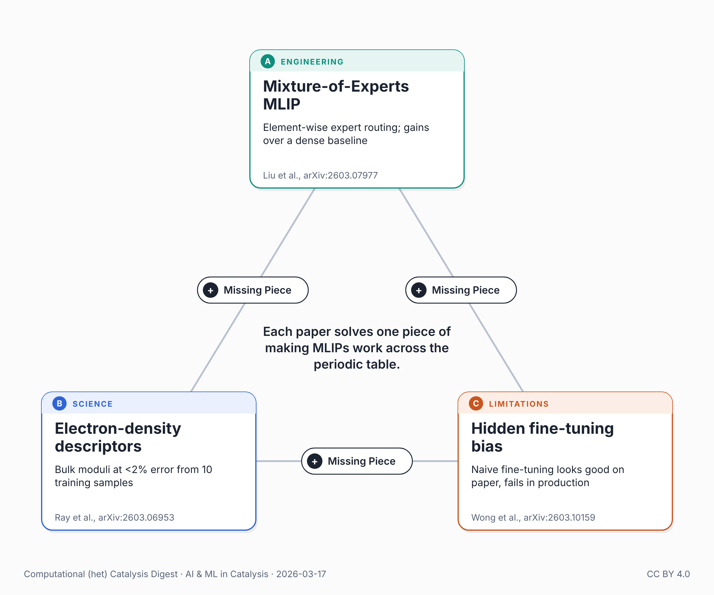

{fig-alt="Triangle of the three papers in this post: Mixture-of-Experts MLIP, electron-density descriptors, and hidden fine-tuning bias."}

Three papers dropped this week asking the same question from different angles: how do you make machine learning potentials work across the periodic table?

The architect builds Mixture-of-Experts into the MLIP. Liu et al. (arXiv:2603.07977) use element-wise routing -- each chemical element activates its own specialized expert -- and show significant accuracy gains over their dense baseline on three major benchmarks (OMol25, OMat24, OC20M). The routing patterns are chemically interpretable: experts self-organize along periodic table groups. A caveat: the paper only benchmarks internally against its own architecture (DPA3), with no comparison to leading equivariant models like MACE or EquiformerV2. Whether MoE on an invariant backbone can compete with the current best remains an open question. The architectural idea is compelling; the proof isn't complete yet.

The descriptor designer uses physics, not just data. Ray et al. (arXiv:2603.06953) skip the expensive DFT self-consistency loop entirely, using non-interacting electron density as descriptors for refractory high-entropy alloys. With Bayesian active learning and just 10 training samples, they predict bulk moduli at <2% error -- and extrapolate to a 7-component system containing four elements the model never saw. Zero-shot generalization from electronic structure, not brute-force data.

The skeptic points to a subtler problem: fine-tuning can introduce hidden biases. Wong et al. (arXiv:2603.10159) show that universal MLIPs, despite low benchmark errors (~0.6 kcal/mol on Matbench Discovery), carry hidden biases. Fine-tune naively -- multiple parallel MD trajectories -- and your model looks good on paper but crashes in production. The fix: periodic fine-tuning from a single evolving trajectory, forcing the model to see its own extrapolation failures in real time.

The question is whether anyone is combining all three: better architectures (MoE) x physics-informed descriptors (electronic manifolds) x bias-aware training protocols. Each paper solves one piece. These preprints appeared within days of each other -- the field is converging on the same problem from multiple directions simultaneously.

For catalyst discovery in high-entropy alloys, for example, where the compositional space is combinatorially vast, this matters. The 4th paradigm in catalysis runs on MLIPs (see my previous post). If the potentials don't generalize, the pipeline doesn't work.

## Connected posts

- [From Data Extraction to Autonomous Discovery](../2026-03-10-ai-catalysis-data-extraction-to-autonomous-discovery/) — the "previous post" referred to above.

## Sources

- Liu et al., arXiv:2603.07977: <https://arxiv.org/abs/2603.07977>
- Ray et al., arXiv:2603.06953: <https://arxiv.org/abs/2603.06953>
- Wong et al., arXiv:2603.10159: <https://arxiv.org/abs/2603.10159>

---

*🤖 This post was researched and drafted with the help of an AI assistant. I reviewed, edited, and approved the final content.*

*Also posted on [LinkedIn](https://www.linkedin.com/posts/juan-m-arce-ramos-phd-43927a85_catalysis-machinelearning-mlips-activity-7439484974942269440-ggz7).*
