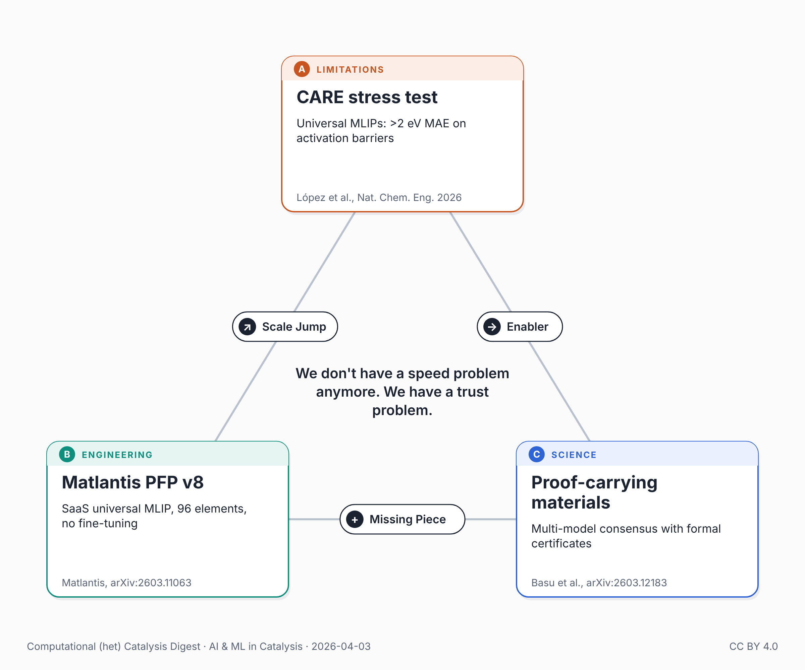

{fig-alt="Triangle of the three works in this post: the CARE stress test, Matlantis PFP v8, and proof-carrying materials."}

On March 2, Amazon's AI coding tools contributed to a deployment that caused ~120,000 lost orders and 1.6 million website errors on their retail site. The company responded with a 90-day code safety reset: all AI-assisted changes now require senior engineer approval.

The same trust gap exists in computational materials science. When a machine learning potential gets a transition state wrong by 2 eV, there's no outage alert. The error propagates silently into catalyst design decisions.

Three developments last month map the problem:

The stress test. López et al. (Nature Chemical Engineering, 2026) built CARE — a framework that generates full reaction networks for heterogeneous catalysis, evaluates 370,000 reactions in 4 hours, and benchmarks universal MLIPs against their own specialized model. Universal potentials produce mean absolute errors above 2 eV on activation barriers. Their specialized GNN (GAME-Net-UQ) achieves 0.33 eV MAE — a 6× gap between what's commercially available and what the chemistry requires.

The commercial bet. Matlantis released PFP v8 (arXiv:2603.11063) — a universal MLIP covering 96 elements, now trained on r2SCAN for better accuracy. It's a SaaS product designed to work without fine-tuning, and companies in batteries, catalysts, and semiconductors are using it off-the-shelf. Matlantis is betting their business model on universal MLIPs being production-ready. The CARE results suggest the gap between "production-ready" and "reliable for reaction barriers" hasn't closed yet.

The engineering fix. Basu et al. (arXiv:2603.12183) show that a single MLIP used as a stability filter misses 93% of DFT-confirmed stable materials. But different architectures fail on different materials — pairwise error correlation between models is near zero (r ≤ 0.13). Their solution: multi-model consensus with formal verification certificates. Auditing multiple MLIPs simultaneously recovers 25% more discoveries than trusting any single model.

The pattern: we don't have a speed problem anymore — universal MLIPs are fast enough. We have a trust problem. And the fix isn't better benchmarks. It's verification infrastructure: multi-model ensembles, formal certificates, domain-specific validation layers.

Amazon's response to its AI code crisis was process — senior review, guardrails, documentation. Materials science needs the computational equivalent.

## Sources

- López et al., *Nat. Chem. Eng.* (2026), CARE: <https://doi.org/10.1038/s44286-026-00361-8>
- Matlantis PFP v8, arXiv:2603.11063: <https://arxiv.org/abs/2603.11063>
- Basu et al., arXiv:2603.12183: <https://arxiv.org/abs/2603.12183>

---

*🤖 This post was researched and drafted with the help of an AI assistant. I reviewed, edited, and approved the final content.*

*Also posted on [LinkedIn](https://www.linkedin.com/posts/juan-m-arce-ramos-phd-43927a85_catalysis-machinelearning-mlips-share-7445511733114490881-9EC3).*
