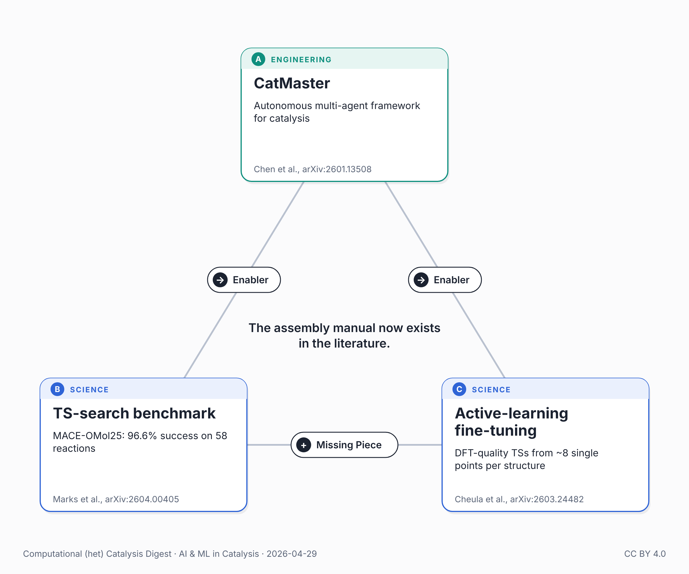

{fig-alt="Triangle of the three papers in this post: CatMaster, a transition-state search benchmark, and active-learning fine-tuning."}

On April 3, Chen et al. (arXiv:2601.13508) published a major revision of CatMaster — an autonomous multi-agent framework for computational catalysis. In it, they named the main thing holding back autonomous catalysis: "bridging the gap to genuine scientific closure requires tighter integration with reliable physical engines."

Two days earlier, someone had published that engine's benchmark.

Marks et al. (arXiv:2604.00405, April 1) ran a systematic test of six machine-learned potentials across 58 diverse reactions using two transition-state search algorithms. The winner: MACE-OMol25, trained on Meta's Open Molecules 2025 dataset, with a 96.6% success rate and fewer than four DFT-gradient evaluations per reaction — a 94-96% reduction versus conventional DFT. For transition-metal catalysis, UMA-Medium showed "promising transferability."

Promising, not ready. For surface catalysis specifically, Cheula et al. (arXiv:2603.24482, March 25) showed why the gap persists and how to close it: active-learning fine-tuning of universal MLPs, with a Bond-Aware Sella algorithm that achieves DFT-quality transition states from only ~8 single-point DFT calculations per structure. Validated on CO₂ hydrogenation networks and single-atom alloy surfaces — the exact systems where universals still fall short.

Three weeks ago I argued the next generation of universal MLIPs would come from whoever combined three layers. The picture was incomplete. These three papers — Marks, Cheula, CatMaster — show the structure of the answer: a benchmark certifies which potential, active learning corrects residual bias, an autonomous framework runs the loop on top. Different layers than I named in March; same architecture of a complete answer.

What they've collectively described is a full pipeline: CatMaster handles autonomous orchestration (project-level reasoning, hierarchical agent loops, closed-loop screening). Marks certifies which MLIP to trust at each precision tier. Cheula handles the surface chemistry fine-tuning layer where universals need help. The assembly manual now exists in the literature. The question is who builds the complete pipeline first — and whether it gets benchmarked against something harder than methanol.

## Connected posts

- [The MLIP Scaling Problem](../2026-03-17-ai-catalysis-mlip-scaling-problem/) — the earlier post on combining three layers, referred to above.

## Sources

- Chen et al., CatMaster, arXiv:2601.13508: <https://arxiv.org/abs/2601.13508>
- Marks et al., arXiv:2604.00405: <https://arxiv.org/abs/2604.00405>
- Cheula et al., arXiv:2603.24482: <https://arxiv.org/abs/2603.24482>

---

*🤖 This post was researched and drafted with the help of an AI assistant. I reviewed, edited, and approved the final content.*

*Also posted on [LinkedIn](https://www.linkedin.com/posts/juan-m-arce-ramos-phd-43927a85_catalysis-machinelearning-computationalchemistry-share-7455255330147442689-QdKO).*
