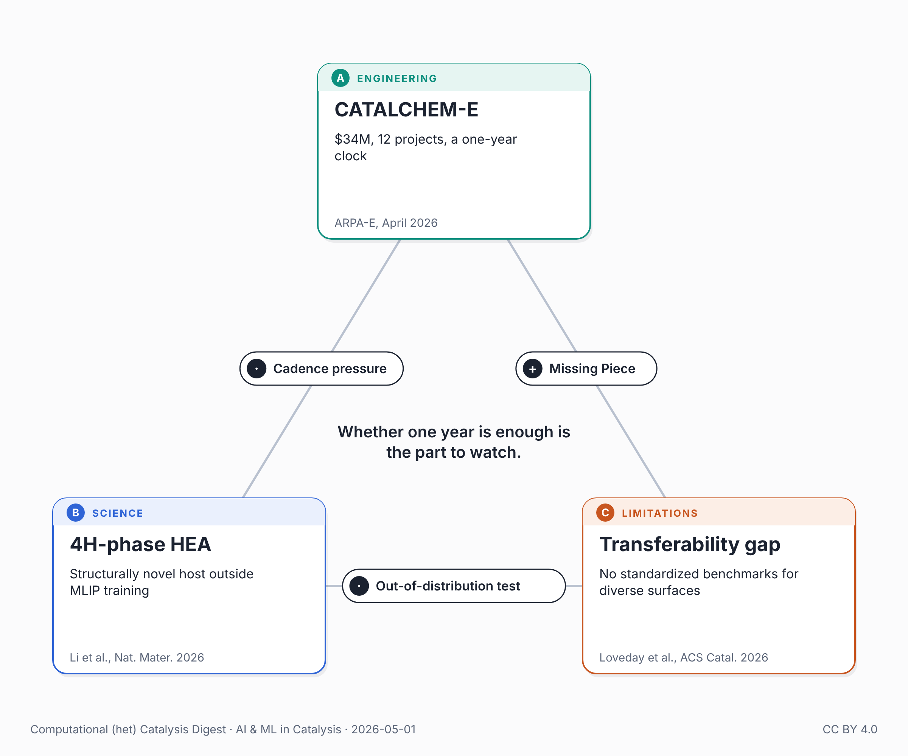

{fig-alt="Triangle of the three works in this post: ARPA-E CATALCHEM-E, a 4H-phase high-entropy alloy, and the universal-MLIP transferability gap."}

On April 13, ARPA-E (USA) committed $34 million to 12 projects tasked with compressing industrial catalyst development from ten years to one. The mechanism: pair AI-guided design with autonomous high-throughput experimentation. The program is CATALCHEM-E.

The same month, Li et al. (Nature Materials, DOI: 10.1038/s41563-026-02562-1) described a synthesis route for 4H-phase high-entropy alloys. Using gold nanowires as structural templates, they stabilized a hexagonal close-packed 4H phase — unconventional for HEAs, which typically adopt face-centered or body-centered cubic structures — and demonstrated water electrolysis activity in the resulting core-shell nanostructures. The 4H phase in a multi-element alloy context is a structure rarely encountered in the training sets of universal machine-learned interatomic potentials.

Also this month, Loveday, Kaźmierczak, and Núria López published a perspective in ACS Catalysis (16(5):4113–4124, DOI: 10.1021/acscatal.5c08945) from the group behind CARE: pretrained universal MLIPs face unresolved transferability challenges for heterogeneous catalysis, and standardized benchmarking protocols for diverse surface environments do not yet exist.

In the previous post, it was argued that autonomous-catalysis stack now exists in the literature, and asked who'd build the complete pipeline first. ARPA-E just answered with $34 million across 12 projects on a one-year clock. Li's 4H-phase HEA isn't a harder reaction — water electrolysis is well-trodden — but it's a structurally novel host outside what universal MLIPs see in training, exactly the kind of out-of-distribution test the López perspective says we have no benchmarks for.

CATALCHEM-E's 1-year timeline rests on a single bet: that today's AI components are reliable enough to compress a decade of catalyst development into twelve months. The program's project descriptions span LLM-driven design, Bayesian optimization, self-driving-lab orchestration, and atomistic simulation. For the part of that bet that runs on universal MLIPs, López's perspective says the standardized benchmarks don't yet exist. Li's 4H-phase HEA is exactly the kind of structurally novel host those benchmarks would need to cover.

Autonomous labs run faster. That speed works in your favor when the computational predictions are correct. When they're not, you generate a lot of experimental data pointing the wrong way.

The $34M investment is well-placed. Whether one year is enough is the part to watch.

## Connected posts

- [The Stack Snaps Into Place](../2026-04-29-ai-catalysis-stack-snaps-into-place/) — the previous post referred to above.

## Sources

- ARPA-E CATALCHEM-E project descriptions (April 2026): <https://arpa-e.energy.gov/sites/default/files/2026-04/CATALCHEM-E_selection_project%20descriptions_final_1.pdf>
- Li et al., *Nat. Mater.* (2026): <https://doi.org/10.1038/s41563-026-02562-1>
- Loveday, Kaźmierczak & López, *ACS Catal.* 16(5), 4113–4124 (2026): <https://doi.org/10.1021/acscatal.5c08945>

---

*🤖 This post was researched and drafted with the help of an AI assistant. I reviewed, edited, and approved the final content.*

*Also posted on [LinkedIn](https://www.linkedin.com/posts/juan-m-arce-ramos-phd-43927a85_catalysis-machinelearning-electrocatalysis-share-7455839952019300352-BzWp).*
