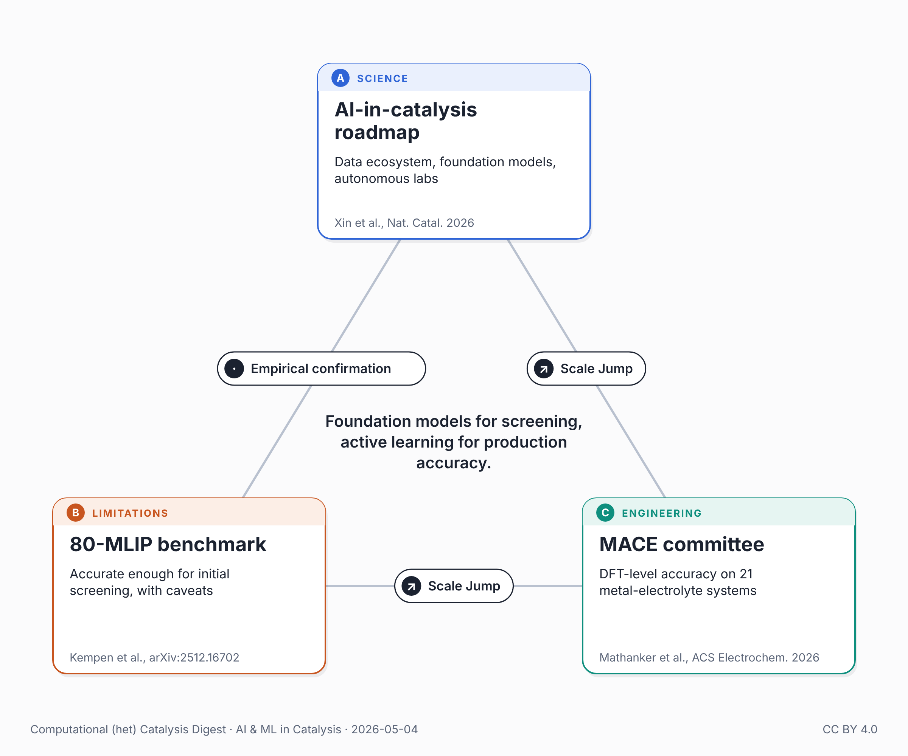

{fig-alt="Triangle of the three papers in this post: the AI-in-catalysis roadmap, an 80-MLIP benchmark, and a MACE committee for metal-electrolyte interfaces."}

The February 2026 Nature Catalysis roadmap from Xin, Kitchin, López and 19 colleagues lays out a three-part path for AI in heterogeneous catalysis: an AI-ready data ecosystem, multimodal foundation models, and autonomous laboratories.

A recent post in this series closed with a question about ARPA-E's CATALCHEM-E program: "Whether one year is enough is the part to watch." Two papers from recent months sharpen the foundation-model picture.

Kempen et al. (arXiv preprint, December 2025, not yet peer-reviewed) benchmarked 80 foundational MLIPs on heterogeneous catalysis tasks. Their headline: no MLIP universally performs best, but the current generation is accurate enough for initial screening on already-relaxed structures. Two caveats matter for production use: MLIP-driven relaxation noticeably degrades accuracy, and many MLIPs catastrophically fail on magnetic materials. The paper traces the second to training-data composition — Open Catalyst datasets handle Co- and Ni-containing surfaces well; OMat24, Alex, and OAM do not.

For metal-electrolyte interfaces — the environment of real electrocatalysts — Mathanker, Guo, Goldsmith, Varley and Govindarajan, in ACS Electrochemistry (April 2026), show that a MACE committee trained via active learning achieves DFT-level accuracy across 21 metal-electrolyte systems (Au, Cu, Rh in aqueous NaCl; potential-dependent properties reproduced).

Two layers: universal foundation models for screening (with attention to relaxation and training-data choice), specialized active learning for production accuracy at specific interfaces. The roadmap drew the architecture. The benchmark and the MACE paper show where each layer stands today.

## Connected posts

- [The Phase Gap](../2026-05-01-ai-catalysis-phase-gap/) — the recent post quoted above.

## Sources

- Xin et al., *Nat. Catal.* 9, 102–111 (2026): <https://doi.org/10.1038/s41929-026-01479-x>
- Kempen et al., arXiv:2512.16702 (Dec 2025, preprint — not yet peer-reviewed): <https://arxiv.org/abs/2512.16702>
- Mathanker et al., *ACS Electrochemistry* (April 2026): <https://doi.org/10.1021/acselectrochem.5c00540>

---

*🤖 An AI assistant did the bulk of the work for this post: weekly literature scan, triangle construction, drafting, and an independent fact-check against the cited papers. My role: directing the topic and iterating on framing. Any corrections or suggestions are welcome.*

*Also posted on [LinkedIn](https://www.linkedin.com/posts/juan-m-arce-ramos-phd-43927a85_catalysis-machinelearning-electrocatalysis-share-7456905198968688640-aUYE).*
