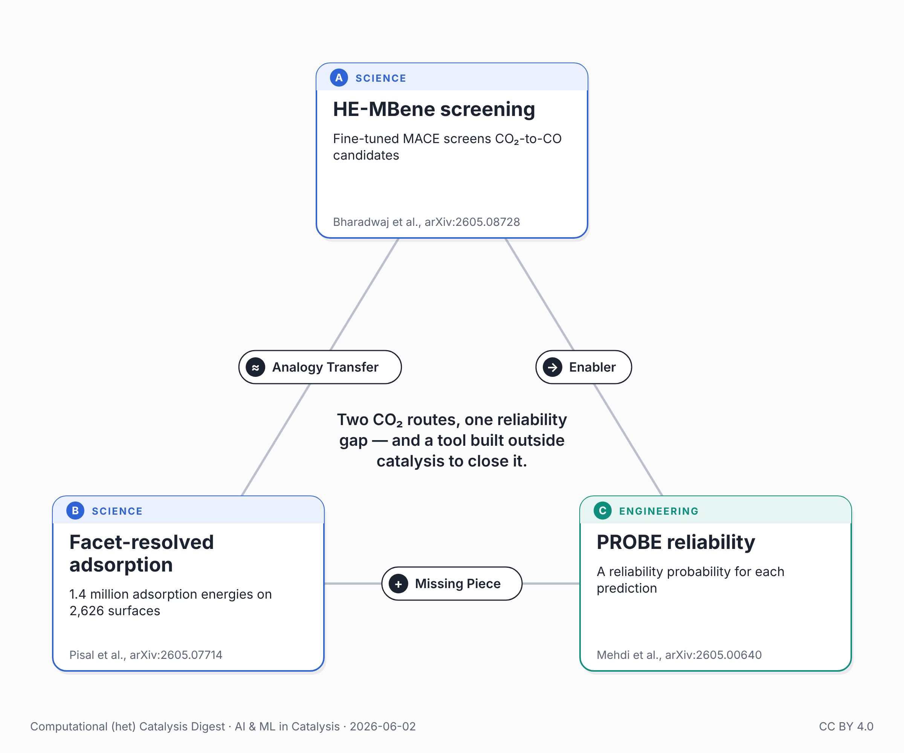

{fig-alt="Triangle of the three papers in this post: high-entropy MBene screening, facet-resolved adsorption-energy distributions, and PROBE per-prediction reliability."}

Two machine-learning papers on CO₂ catalysis appeared within days of each other this month — one electrochemical, one thermal. A third, from a machine-learning group rather than a catalysis lab, quietly addresses a weakness both share.

Bharadwaj et al. (arXiv:2605.08728) screen high-entropy MBenes — five-element 2D borides — for the electrochemical CO₂-to-CO reaction. From 56 candidate compositions they narrow to 55 mechanically stable and 45 thermodynamically stable, using a fine-tuned MACE force field that reaches chemical accuracy (energy RMSE ≈ 3.5 meV/atom) against their DFT data.

Pisal, Krejčí & Rinke (Aalto, arXiv:2605.07714) take the thermal route — CO₂ hydrogenation on alloy nanocatalysts. Using universal force fields trained on Open Catalyst Project data, they compute 1.4 million adsorption energies across 2,626 distinct surfaces, and show that facet-resolved adsorption-energy distributions predict both activity and C1-product selectivity — detail that site-averaged descriptors blur.

Different reactions, different force fields, same foundation: millions of energy predictions on messy, multi-element surfaces. How do you know which ones to trust?

Both teams check their models — Bharadwaj against a held-out test set, Pisal with single-point DFT on three configurations per material–adsorbate pair (mean error 0.11 eV, worst cases discarded). Both are real validation. But both tell you how good the method is on average — not how reliable any single one of those millions of predictions is.

That per-prediction signal is exactly what Mehdi, Cho & Isayev (CMU, arXiv:2605.00640) deliver. Their method, PROBE, reads a trained model's internal representations and returns a reliability probability for each prediction — no retraining — and shows the usual proxy, ensemble disagreement, "correlate[s] weakly with per-molecule prediction error."

Two CO₂ routes, one reliability gap — and a tool, built outside catalysis, designed to close it.

## Sources

- Bharadwaj et al., arXiv:2605.08728 (preprint, May 2026): <https://arxiv.org/abs/2605.08728>
- Pisal, Krejčí & Rinke, arXiv:2605.07714 (preprint, May 2026): <https://arxiv.org/abs/2605.07714>
- Mehdi, Cho & Isayev, arXiv:2605.00640 (preprint, May 2026): <https://arxiv.org/abs/2605.00640>

---

*🤖 An AI assistant did the bulk of the work for this post: weekly literature scan, triangle construction, drafting, and an independent fact-check against the full text of the cited papers. My role: directing the topic and iterating on framing. Any corrections or suggestions are welcome.*

*Also posted on [LinkedIn](https://www.linkedin.com/posts/juan-m-arce-ramos-phd-43927a85_catalysis-machinelearning-electrocatalysis-share-7467409364895600640-F4AE).*
