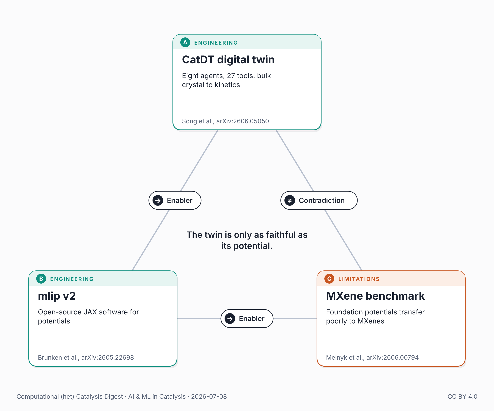

{fig-alt="Triangle of the three papers in this post: the CatDT digital twin, mlip v2 software, and an MXene benchmark of foundation potentials."}

Two recent preprints pushed autonomous catalysis forward, and a third marked where it still stops.

CatDT (Song, Zhang & Cheng, arXiv:2606.05050, June 3) is a self-evolving digital twin: eight agents and 27 tools that turn a bulk crystal and a plain-language reaction description into stable facets, a reconstructed working surface, ranked pathways, transition states, and kinetics — in 5–30 minutes on one GPU. A memory loop lifts barrier-search success from 41% to 84% across 600 surfaces; across seven gas–solid benchmarks, predictions land within 0.5–2× of experiment across four orders of magnitude. For propane dehydrogenation it proposes a non-precious Ni@ZrO₂ overlayer rivaling the Pt industrial benchmark.

A previous post here argued the assembly manual for an autonomous catalysis pipeline "now exists in the literature," and asked who would build it first. CatDT is one answer — and its authors credit not raw model capability but the harness: deterministic tools, persistent memory, verified self-improvement. They're candid about the limit, too: on methanol synthesis the pipeline runs well below the industrial Cu/ZnO/Al₂O₃ benchmark, traced to a systematic gap in the UMA potential underneath.

That gap is the theme. InstaDeep's mlip v2 (Brunken et al., arXiv:2605.22698) is open-source JAX software for training and running interatomic potentials: general-purpose, not catalysis-specific, but the layer these twins run on.

And Melnyk et al. (arXiv:2606.00794, May 30) mark the binding constraint. Their MXene benchmark finds foundation potentials — MACE, PET, MatRIS — transfer poorly to 2D MXenes, whose surface terminations are underrepresented in training data. The fix works, at a price: a bespoke 50,000-structure DFT set to reach ±10 meV/Å on forces, for one materials family.

Orchestration is being solved, the engine open-sourced. What doesn't transfer is the DFT data each genuinely new chemistry demands — and CatDT's methanol shortfall is what that gap costs. The twin is only as faithful as its potential.

Note: all three are arXiv preprints, not yet peer-reviewed.

## Connected posts

- [The Stack Snaps Into Place](../2026-04-29-ai-catalysis-stack-snaps-into-place/) — the previous post quoted above.

## Sources

- Song, Zhang & Cheng, CatDT, arXiv:2606.05050: <https://arxiv.org/abs/2606.05050>
- Brunken et al., mlip v2, arXiv:2605.22698: <https://arxiv.org/abs/2605.22698>
- Melnyk et al., arXiv:2606.00794: <https://arxiv.org/abs/2606.00794>

---

*🤖 An AI assistant did the bulk of the work for this post: weekly literature scan, triangle construction, drafting, and an independent fact-check against the cited papers. My role: directing the topic and iterating on framing. Any corrections or suggestions are welcome.*

*Also posted on [LinkedIn](https://www.linkedin.com/posts/juan-m-arce-ramos-phd-43927a85_catalysis-machinelearning-autonomouslabs-share-7480519528284880896-7X09).*
