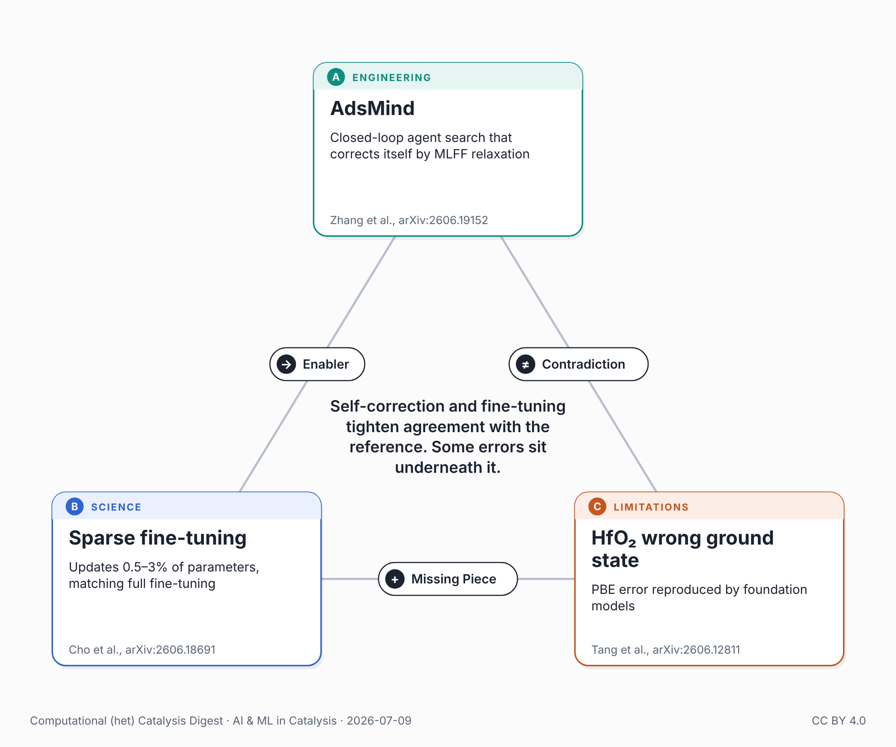

{fig-alt="Triangle of the three papers in this post: AdsMind, sparse fine-tuning of foundation potentials, and the HfO₂ wrong ground state."}

Two recent preprints make machine-learning catalysis more trustworthy. A third, posted alongside them, asks what the trust is anchored to.

AdsMind tackles a bottleneck: finding the lowest-energy way an adsorbate sits on a catalyst surface. Open-loop LLM agents guess a configuration and commit to it; AdsMind runs each guess through a machine-learning force-field relaxation and corrects itself. It hits 100% and 98.8% search success on two benchmarks with about four relaxations per case — a 14-fold cut over enumeration — and, checked against VASP/PBE, keeps the correct adsorption-energy sign on every tested system where an open-loop competitor flips it. Its energies still only loosely track PBE (1.55 eV mean error, overbinding some alloys); the gain is search reliability, not quantitative accuracy.

The other reliability move is specialization. Cho et al. fine-tune equivariant foundation potentials by updating as little as 0.5–3% of parameters, matching full fine-tuning — cheap enough to recalibrate a general model to a target chemistry as routine.

Both anchor "correct" to a DFT reference. Tang et al. show what that reference can hide. A PBE-trained potential ranks a spurious I4₁/amd phase of HfO₂ below the experimentally established monoclinic ground state — wrong, by about 17 meV per formula unit. The widely used foundation models NequIP-OAM-L, MatterSim-v1-5M and MACE-MP-0 reproduce it, because the error lives in the PBE functional, not any one model. Other functionals — PBEsol, LDA — largely suppress it.

A recent post here argued the autonomous "twin is only as faithful as its potential" — its limit the bespoke DFT data each new chemistry needs. HfO₂ drops that floor a level: the reference that data is computed against can itself be wrong. An earlier post held the fix for MLIP trust "isn't better benchmarks" but "verification infrastructure." That's the case it can't reach — when models share a functional, their consensus confirms the wrong answer, and PBE validation agrees.

Self-correction and fine-tuning tighten agreement with the reference. Some errors sit underneath it — where neither the agent nor the fine-tune is looking.

Note: all three are arXiv preprints; no journal versions yet.

## Connected posts

- [The Twin Is Only As Good As Its Potential](../2026-06-07-ai-catalysis-twin-only-as-good/) — the recent post quoted above.
- [The Trust Gap in Universal MLIPs](../2026-04-03-ai-catalysis-trust-gap/) — the earlier post quoted above.

## Sources

- Zhang et al. (AdsMind), arXiv:2606.19152: <https://arxiv.org/abs/2606.19152>
- Cho et al. (sparsity fine-tuning), arXiv:2606.18691: <https://arxiv.org/abs/2606.18691>
- Tang et al. (HfO₂ wrong ground state), arXiv:2606.12811: <https://arxiv.org/abs/2606.12811>

---

*🤖 An AI assistant did the bulk of the work for this post: weekly literature scan, triangle construction, drafting, and an independent fact-check against the cited papers. My role: directing the topic and iterating on framing. Any corrections or suggestions are welcome.*

*Also posted on [LinkedIn](https://www.linkedin.com/posts/juan-m-arce-ramos-phd-43927a85_catalysis-machinelearning-mlip-share-7480895675774431232-ozjo).*
